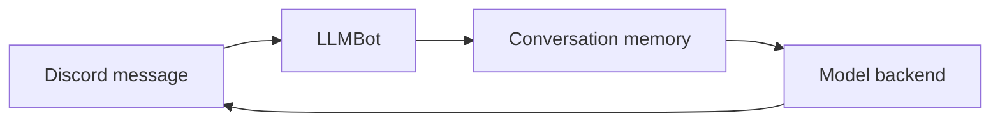

# Discord LLM Bot

여러 사용자가 Discord에서 언어모델과 대화할 수 있도록 만든 범용 봇입니다.
문헌검색 봇과는 목적과 대화 흐름이 달라 별도 프로젝트로 유지합니다.

| 파일 | 역할 |
|---|---|
| `llmbot.py` | 멘션·명령 처리와 대화 흐름 |
| `models.py` | 원래 봇이 사용하는 LangChain 모델 loader |
| `memory.py` | context window와 Elasticsearch 기반 장기 메모리 |
| `utils.py` | Discord 이름·멘션과 프롬프트 변환 |
| `utilbot.py` | 보조 봇 기능 |
| `api_adapters/` | 서버에 있던 별도 OpenAI/Gemini API 어댑터 실험 |

`models.py`와 동명의 `models/` 패키지가 함께 있어 `load_model` import가
가려지는 문제가 있었습니다. 별도 어댑터를 `api_adapters/`로 옮겨 구분했습니다.
이 어댑터를 기존 봇의 모델 loader에 새로 연결한 것은 아닙니다.

Discord 토큰, 모델 API 키, 서버·채널 ID, 대화 기록, Elasticsearch 데이터와
Hydra 설정은 포함하지 않습니다. 현재 코드는 과거 LangChain 인터페이스를
사용하며 최신 버전 호환을 검증하지 않았습니다. 실행에는 `discord.py`,
LangChain, Hydra/OmegaConf 및 선택한 모델·메모리 backend가 필요합니다.
